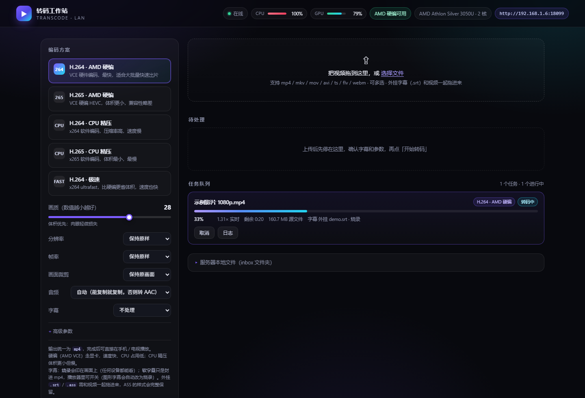

# Transcode LAN

[简体中文](README.md) · [English](README.en.md)

Turn a Windows PC into a **LAN video transcoding server**: a phone, a tablet or another PC opens a web page, uploads videos, queues them for transcoding and downloads the results. Under the hood it drives the official **HandBrakeCLI** (1.11.2) and supports AMD hardware encoding, CPU-heavy presets and subtitle burn-in.

> A tiny zero-dependency video transcoding server for your LAN. It is a single ~60 KB
> .NET Framework 4.8 executable that ships its own HTTP server and web UI, and drives
> the official `HandBrakeCLI` to transcode videos. Drop a file in the browser, pick a
> preset, get an MP4 back. Windows only, no admin rights required to run.



**Why bother**: no Docker, no Python, no Node, no runtime to install (Windows already
ships .NET Framework 4.8). One exe plus one web page turns an idle office PC into
"throw a video in, take an MP4 out".

> **Project status: a personal hobby project. Update pace is not guaranteed.**
> The code only runs on the author's own machine and there is no dedicated maintenance
> time — new features, fixes and issue replies have no timeline.
> **NVIDIA (NVENC) and Intel (Quick Sync) hardware encoding are planned** (see
> [Roadmap](#13-roadmap)). Until then, machines with an NVIDIA or Intel GPU should use
> one of the CPU presets.

---

## 1. What it does

- **Upload and queue in the browser**: drag & drop or multi-select. Files first land in a *staged* area, so you can confirm settings before pressing **Start**. Progress, speed (× realtime), ETA, logs and cancel are all in the page.
- **Five encoding presets**: AMD VCE H.264/H.265, x264/x265 software presets, and an x264 ultra-fast preset.
- **Quality / resolution / frame rate / cropping / audio** are adjustable: CQ/CRF 18–34, 1080p/720p/480p, 30/25/24 fps, cropping can keep the source picture or auto-crop black bars, and audio is "copy the stream, fall back to AAC".
- **Custom arguments passed through verbatim**: whatever you type in the advanced box is appended to the `HandBrakeCLI` command line (e.g. `-b 2000`, `--decomb`, `--crop 0:0:0:0`).
- **Subtitle handling**:
  - none / **burn-in** / **soft subtitles** (mov_text, can be toggled in the player);
  - embedded tracks prefer Chinese (chi/zho/Chinese, simplified or traditional) and can be pinned to track 1–4;
  - external `.srt` / `.ass` / `.ssa` are auto-paired by identical name or shared prefix, or attached manually;
  - **ASS burn-in keeps its styling**: ASS is losslessly muxed into a temporary MKV with `ffmpeg`, then rendered by HandBrake's libass, so fonts, colours, positions and effects survive;
  - bitmap subtitles (PGS/VobSub) switch to burn-in automatically, because MP4 cannot carry them;
  - non-UTF-8 (e.g. GBK) subtitles are converted to UTF-8; sources with a negative container start (vp9/opus MKV, TS) get the subtitle track nudged forward so the first lines are not dropped.
- **Three ways to feed it**: browser upload / drop files into the `inbox` folder and press *Add to queue* / enable `autoQueue` and let it watch `inbox`.
- **Live load meter**: the header shows CPU usage and **GPU video codec engine** usage (the `Video Codec` engine, not 3D), plus free disk space, uptime and LAN addresses.
- **Jobs survive restarts**: `data/jobs.json` is reloaded on startup; jobs interrupted by a restart are marked *interrupted by service restart*.
- **Download and playback**: downloads support `Range` (resume / progressive playback); non-ASCII filenames use RFC 5987 encoding.
- **Helper scripts**: firewall rule, autostart (scheduled task, or a Startup-folder shortcut launching a hidden window), start / stop / status.

---

## 2. Requirements

| Item | Requirement |
| --- | --- |
| OS | Windows 10 / 11 (or Windows Server with .NET Framework 4.8) |
| Runtime | **.NET Framework 4.8** (bundled with Win10 1903+ / Win11, nothing to install) |
| Transcoding engine | `bin\HandBrakeCLI.exe` (not vendored, download it with a script) |
| Helper tool | `bin\ffmpeg.exe` (only needed for style-preserving ASS burn-in; not vendored) |
| Privileges | **No admin rights** for daily use; one-time admin for the firewall rule and autostart |
| UI language | The web interface is currently Chinese only |

> Hardware encoding is detected at startup: the console prints
> `[AMD VCE hardware encode: YES]`. Without it the service still works — the header just
> shows hardware encoding as unavailable, and you use a CPU preset.

---

## 3. Quick start

**Easiest: grab a release.** The `transcode-lan-1.0.0-win-x64-full.zip` archive under
[Releases](https://github.com/qiorz/transcode-lan/releases) already contains HandBrakeCLI and
FFmpeg — unzip it and double-click `启动服务.bat`. No Git, no build step.
The four steps below are only needed if you want to change or rebuild the code.

```powershell
# 1. clone
git clone https://github.com/qiorz/transcode-lan.git
cd transcode-lan

# 2. build TranscodeServer.exe (uses the csc shipped with Windows, no Visual Studio)
powershell -ExecutionPolicy Bypass -File build.ps1

# 3. download HandBrakeCLI + ffmpeg into bin\
powershell -ExecutionPolicy Bypass -File scripts\get-binaries.ps1

# 4. run in the foreground so you can see the log and the real URLs
.\启动服务.bat
```

The console prints the addresses it is listening on:

```
  URL       : http://192.168.1.23:8099/
  URL       : http://127.0.0.1:8099/
```

On the same machine, just open <http://127.0.0.1:8099>.

**Let phones and other devices connect** (one-time setup):

1. double-click `设置开机自启.bat` (enable autostart — starts in the background at logon, no admin rights);
2. double-click `初始化.bat` (or `仅放行防火墙.bat`) and click *Yes* on the UAC prompt;
3. connect the phone to the same Wi-Fi and open `http://<this-pc-ip>:8099`.

> Windows Firewall blocks inbound connections by default. Step 1 alone is enough for the
> local machine, but phones cannot connect until port 8099 is allowed — that single step
> needs administrator rights.

**Manual build** (equivalent to `build.ps1`):

```powershell
& "$env:WINDIR\Microsoft.NET\Framework64\v4.0.30319\csc.exe" /target:exe /platform:anycpu /optimize+ `
  /codepage:65001 /out:TranscodeServer.exe `
  /reference:"$env:WINDIR\Microsoft.NET\Framework64\v4.0.30319\System.Web.Extensions.dll" `
  /reference:"$env:WINDIR\Microsoft.NET\Framework64\v4.0.30319\System.Management.dll" `
  src\server.cs
```

---

## 4. Workflow

1. **Upload**: drop videos onto the dashed box (or click *Choose files*, multi-select allowed). Uploaded files stay in the **staged** area and do **not** start yet.
2. **Adjust**: drop a subtitle file at this point (it is paired with the matching video), and pick the preset, quality, cropping and subtitle mode on the left.
3. **Start**: press **Start** when it looks right, or *Start all*.
4. **Wait**: each card shows percentage, speed and ETA. Only one job runs at a time by default (`maxParallel`).
5. **Collect**: press *Download* when done. *Delete* also removes the output file.

Staged cards already show what was detected, e.g. `2 embedded: Chinese (SRT), English (SRT)`,
`external movie.srt`, `no embedded subtitles` — **you can see whether subtitles were picked up
before starting**.

---

## 5. Encoding presets

The built-in presets live in `Profiles.All` in `src/server.cs`. The numbers below were
measured on the author's reference machine (Athlon Silver 3050U, 2 cores + Radeon
integrated GPU, 1080p60 10-second source):

| Preset | Encoder | Encoding speed | Time for 10 s | Notes |
| --- | --- | --- | --- | --- |
| H.264 · AMD VCE | `vce_h264` | ≈ 60 fps (1.0× realtime) | 13 s | **Default**, runs on the GPU, low CPU usage |
| H.265 · AMD VCE | `vce_h265` | ≈ 70 fps | 11 s | ~30% smaller at similar quality, worse compatibility with old devices |
| H.264 · CPU, best compression | `x264 veryfast` | ≈ 33 fps (0.5×) | 21 s | Best compression, good for long-term archiving |
| H.265 · CPU, best compression | `x265 ultrafast` | ≈ 15 fps | 25 s | Smallest files, but slow on 2 cores |
| H.264 · ultra fast | `x264 ultrafast` | ≈ 45 fps | 16 s | Smaller than VCE at similar speed |

> These are only orders of magnitude. Typical 1080p30 movie content runs at roughly
> 1.8× these numbers; 4K sources are noticeably slower. A faster CPU/GPU helps.

**Quality** (CQ/CRF, 18–34): lower is sharper and larger. Defaults: VCE 28, x264 23, x265 25.

> ⚠️ If the source was already compressed hard (low-bitrate clips from social apps),
> transcoding can make the file **bigger** — the encoder allocates bitrate by picture
> complexity. Either downscale or push quality to 32+ in that case.

**Custom arguments** are appended to `HandBrakeCLI` verbatim, for example:

- `-b 2000`: fixed 2 Mbps bitrate (disables the quality setting automatically)
- `--decomb`: deinterlace (old DVDs, TV recordings)
- `--crop 8:8:8:8`: manual crop (top:bottom:left:right pixels)

### Cropping

The *Cropping* dropdown has two options:

- **Keep the source picture** (default): the output resolution matches the source exactly. The server passes `--crop 0:0:0:0` explicitly, so HandBrake never crops black bars on its own.
- **Auto-crop black bars**: HandBrake detects and removes the bars. For example, 4:3 content inside a 4K frame becomes 2880×2160 — fewer bits for the same quality, but the **output resolution changes**.

> Keep the default for mixed footage (16:9 and 4:3 in one file); otherwise the whole file is cropped with a single aspect ratio and the other parts may lose picture.
>
> ⚠️ Both the dropdown and the custom arguments can emit `--crop`. When both are present, which one wins depends on HandBrake's argument parsing — use only one of them.

### Why only AMD hardware encoding is built in

The project was developed on an AMD integrated GPU, so the hardware presets use
`vce_h264` / `vce_h265`. **On NVIDIA and Intel machines those two presets fail** (and the
startup banner will not report hardware encoding) — select a CPU preset and everything
works.

Built-in NVENC / Quick Sync presets are on the [roadmap](#13-roadmap) but not done yet.
If you need them now, add your own preset by checking the encoder names first:

```powershell
.\bin\HandBrakeCLI.exe --encoder-list
```

Then add an entry to `Profiles.All` — the exact encoder name must match `--encoder-list`
output, since it differs between HandBrake versions:

```csharp
new Profile { id = "h264-nvenc", label = "H.264 · NVENC", desc = "NVIDIA hardware encoding",
              encoder = "nvenc_h264", preset = "balanced", quality = 28, family = "gpu" },
```

Rebuild with `build.ps1` and the preset appears in the web UI automatically
(`/api/profiles` is served dynamically).

---

## 6. Subtitles

The *Subtitle* dropdown has three options:

| Option | Effect | When to use |
| --- | --- | --- |
| none | Output has no subtitles | Subtitles not needed |
| **Burn-in** | Subtitles are rendered into the picture; every device and player shows them | Old TVs, car head units, clips sent through chat apps |
| Soft subtitles | Subtitles are muxed into the MP4 (mov_text) and can be toggled in the player | Watching on a PC/phone and keeping the original track |

**Track selection**: the default is *auto (prefer Chinese)* — the server looks for a
Chinese track (chi/zho/中文/simplified/traditional) and falls back to the first track.
You can also force track 1/2/3/4.

Cards show the track actually used, e.g. `subtitle Chinese (TX3G) · burn-in`, or warn with
`no subtitle track in source`.

**External subtitles (.srt / .ass / .ssa)** — three ways:

1. drop them **together with** the video (`movie.mp4` + `movie.srt`; identical names or a shared prefix both pair up);
2. upload the video first and the subtitle afterwards — while the video is staged, dropping a subtitle pairs it automatically;
3. when names do not match, click *Attach subtitle* on the card.

A paired subtitle shows as `external movie.srt`. If the *Subtitle* mode is *none*, the card
warns you and offers a *Burn subtitle and start* shortcut.

You can also put the video and subtitle (same name) into the `inbox` folder; *Add to queue*
picks the subtitle up automatically.

> **Burn-in goes through HandBrake's libass.** Two paths:
> - `.srt`: `--srt-file ... --srt-burn=1`, burned directly.
> - `.ass` / `.ssa`: HandBrake's external-subtitle interface only accepts SRT, so `bin\ffmpeg.exe` first **losslessly muxes** the ASS into a temporary MKV (stream copy, no re-encode, a few seconds), and HandBrake then renders it with libass — **fonts, colours, positions and effects are preserved**.
>
> If an ASS file is used as *soft* subtitles, MP4 cannot hold it and it is converted to
> mov_text (text only, styling lost). If you want to keep the styling, choose burn-in.

**Bitmap subtitles (PGS / VobSub)** are images rather than text and MP4 cannot carry
them, so *soft* is silently changed to burn-in.

> Burn-in makes encoding slightly slower (the subtitle has to be rendered) — about
> 5%–10% more time with the hardware presets.

---

## 7. Configuration

`data/config.json`:

| Field | Default | Meaning |
| --- | --- | --- |
| `port` | 8099 | Web port. Changing it needs a new firewall rule (below) |
| `handbrake` | `bin\HandBrakeCLI.exe` | Path to HandBrakeCLI |
| `ffmpeg` | `bin\ffmpeg.exe` | Used for the lossless ASS mux; empty means "look in `bin\` then `PATH`" |
| `maxParallel` | 1 | Concurrent transcodes. Do not exceed 1 on a 2-core machine |
| `autoQueue` | false | Automatically queue new files in `inbox` |
| `autoProfile` | `h264-vce` | Preset used by auto-queue |
| `autoSubtitle` | none | Subtitle mode used by auto-queue: `none` / `burn` / `soft` |

Firewall rule for a changed port (administrator command prompt):

```bat
netsh advfirewall firewall add rule name="Transcode LAN 8299" dir=in action=allow protocol=TCP localport=8299 profile=private,domain
```

> `初始化.bat` / `仅放行防火墙.bat` read the port from `data/config.json` and create the
> rule for you, so you rarely need this by hand.

---

## 8. HTTP API

The web UI is just a static `web/index.html`; everything goes through these endpoints,
so they are easy to drive from scripts or shortcuts:

| Method | Path | Purpose |
| --- | --- | --- |
| GET | `/health` | Liveness check, returns `ok` |
| GET | `/api/status` | Service info, CPU/GPU load, disk space, LAN addresses |
| GET | `/api/profiles` | Available encoding presets |
| GET | `/api/jobs` | Job list |
| POST | `/api/jobs` | Create and enqueue a job (JSON body) |
| GET | `/api/jobs/{id}` | Single job |
| DELETE | `/api/jobs/{id}?purge=1` | Remove a job; `purge=1` also deletes output and source |
| POST | `/api/jobs/{id}/cancel` | Cancel |
| GET | `/api/jobs/{id}/log` | Job log (plain text) |
| GET | `/api/jobs/{id}/download` | Download the output (supports `Range`) |
| GET | `/api/jobs/{id}/source` | Stream the source file (supports `Range`) |
| PUT | `/api/upload?name=movie.mp4&group=xxx` | Upload; the body is the raw bytes |
| GET | `/api/inbox` | Files waiting in the `inbox` folder |
| GET | `/api/probe?source=work/xxx/movie.mp4` | Probe duration / resolution / subtitle tracks |
| DELETE | `/api/staged?source=work/xxx/movie.mp4` | Discard an uploaded file that was never queued |

Example:

```powershell
$body = @{
  source        = "work/20260101-120000-ab12cd/movie.mp4"
  profile       = "h264-vce"
  quality       = 28
  resolution    = "1080p"
  cropMode      = "none"   # none = keep the source picture, auto = crop black bars
  subtitleMode  = "burn"
  subtitleTrack = "auto"
} | ConvertTo-Json

Invoke-RestMethod -Method Post -Uri http://127.0.0.1:8099/api/jobs -ContentType 'application/json' -Body $body
```

---

## 9. Project layout

```
transcode-lan\
├─ src\server.cs           Server source (single file, ~2400 lines)
├─ build.ps1               Build script (uses the csc shipped with Windows, no VS)
├─ TranscodeServer.exe     Build output (.gitignore'd, build it yourself)
├─ web\index.html          Web UI (single file, safe to edit)
├─ bin\                    HandBrakeCLI.exe / ffmpeg.exe (not vendored, download with a script)
├─ scripts\
│   ├─ get-binaries.ps1    Download HandBrakeCLI + ffmpeg into bin\
│   ├─ setup.ps1           Firewall rule + autostart (needs admin)
│   ├─ autostart.ps1       Install / remove autostart
│   ├─ remove-autostart.ps1  Remove autostart
│   ├─ service.ps1         Start / stop / status (called by the .bat files)
│   └─ launch-hidden.vbs   Start with a hidden console window
├─ 初始化.bat              Firewall + autostart (UAC)
├─ 设置开机自启.bat        Start in the background at logon (no admin)
├─ 取消开机自启.bat        Remove autostart
├─ 仅放行防火墙.bat        Firewall rule only (UAC)
├─ 开启.bat                Start in the background and open the page
├─ 关闭.bat                Stop the service (interrupts running jobs)
├─ 启动服务.bat            Start in the foreground (shows the log)
├─ 打开网页.bat            Open the local page
├─ data\
│   ├─ config.json         Configuration
│   ├─ jobs.json           Job records (generated at runtime, ignored)
│   └─ logs\               Full per-job logs (generated at runtime, ignored)
├─ work\                   Uploaded sources (one folder per job)
├─ output\                 Finished files (downloads read from here)
├─ inbox\                  Drop files here to queue them from the web UI
└─ docs\                   Screenshots
```

---

## 10. FAQ

**The phone cannot open the page**
1. Are both devices on the same Wi-Fi / subnet?
2. Have you run `初始化.bat` or `仅放行防火墙.bat`?
3. Is the Windows network profile set to *Private*? (Settings → Network & Internet → Ethernet → network profile)
4. Is the service actually running? Try <http://127.0.0.1:8099> on the host first.

**Port already in use**: change `port` in `data/config.json`, allow it in the firewall, then start again. For a quick test, `TranscodeServer.exe --port 8098` also works.

**Transcoding failed**: open the job's *Log*. The usual suspects are a full disk, a corrupt source, or a bad custom argument.

**Subtitles were not burned in**: check the staged card first —
- `no embedded subtitles` and no `external …` tag → the video really has no subtitles; attach a `.srt`.
- a tag is there but the card says *subtitles may not have been burned* → open the log and search for `Burn-in`.
- `bitmap subtitle … switched to burn-in` → expected, PGS can only be burned.
- `ASS/non-UTF-8 subtitle converted to plain style` → expected; styling is lost, text remains.
- **The first few lines are missing**: HandBrake drops subtitle packets that start before the first video frame. When the container start is negative or non-zero (common for vp9+opus MKV and TS), the mux step shifts the subtitle track by `|start| + 0.1` s; the log prints `nudging subtitles +0.1xx s`.

**I want different subtitle position / styling**: burn-in uses libass defaults (white text, black outline, bottom centre) and HandBrake CLI exposes no size/position options. For full control, upload a styled `.ass` file — ASS keeps its own styling.

**What about shutdown or sleep**: running jobs are interrupted; on the next start they are marked *interrupted by service restart*. Add them again.

**Is it heavy on power / will it get hot**: hardware encoding uses the integrated GPU, so overall power draw stays modest, but fans spin up during batches. Overnight runs are a good idea.

**Complete uninstall**:
1. run `取消开机自启.bat`;
2. delete the folder;
3. delete the firewall rule (administrator command prompt):
   `netsh advfirewall firewall delete rule name="Transcode LAN 8099"`.

---

## 11. Security

**There is no login, no password and no HTTPS. It is meant for a trusted LAN only. Do not
port-forward it or expose it through a tunnel.** For remote access, put it behind a VPN
or an authenticating reverse proxy.

If you publish or share this project, keep these deliberate design choices in mind
(they are not vulnerability reports):

- anyone who can reach the port can upload, queue, cancel, delete and download;
- responses carry `Access-Control-Allow-Origin: *`, which makes it easy to call from other
  pages on the LAN — but it also means any web page in the same browser can call
  `127.0.0.1:8099`;
- `POST /api/jobs` accepts absolute `source` paths, so any locally readable file can be
  transcoded and downloaded (the web UI only ever sends staged paths, but do not expose
  this service to an untrusted network);
- uploads have no size limit beyond free disk space.

If you need multi-user access or public exposure, use it as an intranet tool only, or add
an authenticating reverse proxy in front of it.

---

## 12. Known limitations

- **Windows only**: relies on .NET Framework 4.8, WMI performance counters, `netsh` and `schtasks`.
- **Hardware encoding is AMD-only for now**: NVENC / Quick Sync are on the roadmap; today you add a preset yourself (see above).
- **MP4 output only**: no HDR metadata preservation, chapter editing or two-pass encoding (custom arguments can cover some of it).
- **No chunked uploads**: requests must send `Content-Length` (browsers and `curl --data-binary` do).
- **No tests and no CI**: it is a single-machine tool; the verification method is to transcode a video.
- **The web UI is Chinese only** at the moment.
- In-memory logs keep the last 400 lines; full logs live in `data\logs\`.

---

## 13. Roadmap

Driven purely by interest, with no schedule:

- [ ] **NVIDIA NVENC hardware presets** (`nvenc_h264` / `nvenc_h265`)
- [ ] **Intel Quick Sync hardware presets** (`qsv_h264` / `qsv_h265`)
- [ ] Detect available encoders at startup with `HandBrakeCLI --encoder-list`, so the UI only offers presets that actually work
- [ ] Allow-list the source path for `POST /api/jobs` (restrict to `work/` and `inbox/`)
- [ ] Optional password protection, for slightly less trusted networks

> This is a hobby project: the order above and any completion time are not promised, and
> issues / PRs may take a while. Use it if it fits; if you cannot wait, change it — the
> server is one `server.cs` of under 2400 lines, small enough to understand without docs.

---

## 14. Licensing and third-party components

The project's own code is released under the **GNU GPL v3.0 (or later)**, see [LICENSE](LICENSE).
Copyright © 2026 qiorz.

> Why GPL instead of MIT: the `-full` release bundle ships HandBrake and FFmpeg together with
> this code, and staying in the same license family makes the redistribution obligations
> straightforward.

The two third-party programs are **not committed to the repository**, but the `-full` release
bundle contains them:

| Component | License | Purpose |
| --- | --- | --- |
| [HandBrake](https://handbrake.fr/) / HandBrakeCLI 1.11.2 | GPL-2.0 | The actual transcoding engine, invoked as a separate command-line program |
| [FFmpeg](https://ffmpeg.org/) | GPL-3.0 (the official essentials build enables `--enable-gpl --enable-version3`) | Only used for the lossless ASS subtitle mux |

Every release bundle carries:

- `THIRD-PARTY-NOTICES.md` and `licenses\` (verbatim GPL-2.0 / GPL-3.0 texts) stating exact versions, sources and source-code locations;
- unmodified official builds of both programs, invoked through the command line — aggregated with this project, not linked into it;
- a pointer to this repository for this project's source; if you only want the program, clone and run `build.ps1`.

`scripts/get-binaries.ps1` merely downloads them from their official releases and never
commits them — the repository stays small and `git clone` stays fast.

---

## Credits

- [HandBrake](https://handbrake.fr/) — a rock-solid transcoding engine.
- The subtitle burn-in approach builds on HandBrake's `--srt-file` / `--srt-burn` flags and
  its libass rendering pipeline.
