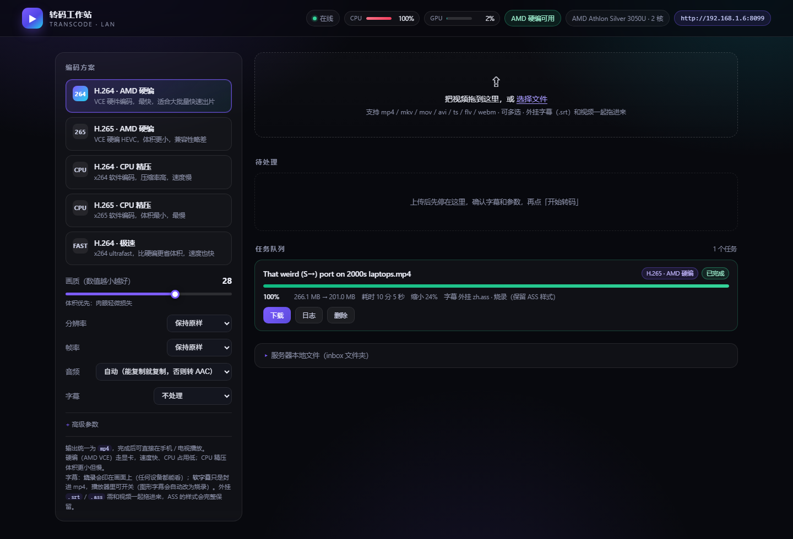

# 转码工作站 · Transcode LAN

[简体中文](README.md) · [English](README.en.md)

把一台 Windows 电脑变成**局域网转码服务器**：手机、平板、另一台电脑打开一个网页，就能上传视频、排队转码、下载成品。底层直接调用官方 **HandBrakeCLI**（1.11.2），支持 AMD 硬件编码、CPU 精压、字幕烧录。

> A tiny zero-dependency video transcoding server for your LAN. It is a single ~60 KB
> .NET Framework 4.8 executable that ships its own HTTP server and web UI, and drives
> the official `HandBrakeCLI` to transcode videos. Drop a file in the browser, pick a
> preset, get an MP4 back. Windows only, no admin rights required to run.



**为什么用它**：不用 Docker、Python、Node，不用装任何运行时（Windows 自带 .NET Framework 4.8），
一个 exe + 一个网页就能把闲置的办公机变成“丢视频进去、拿成品出来”的转码站。

> **项目状态：个人爱好项目，更新节奏不保证。**
> 代码只在自己的一台机器上跑，没有专职维护时间 —— 新功能、修复和 issue 回复都不承诺时间表。
> 后续计划补上 **NVIDIA（NVENC）和 Intel（Quick Sync）硬件编码**支持；在此之前，N 卡 / Intel 核显的机器请先选 CPU 方案（见文末「路线图」）。

---

## 一、能做什么

- **网页上传与排队**：拖拽或多选上传，文件先停在「待处理」区，确认参数后再「开始转码」；进度、速度（×实时）、剩余时间、日志、取消全在网页里。
- **5 套编码方案**：AMD 硬编 H.264/H.265（VCE）、x264/x265 软件精压、x264 极速。
- **画质 / 分辨率 / 帧率 / 音频**可调：CQ/CRF 18–34，1080p/720p/480p，30/25/24fps，音频「能复制就复制，否则转 AAC」。
- **高级参数透传**：界面上填的内容会原样拼给 `HandBrakeCLI`（例如 `-b 2000`、`--decomb`、`--crop 0:0:0:0`）。
- **字幕三件套**：
  - 不处理 / **烧录成硬字幕** / **软字幕**（mov_text，可开关）；
  - 内嵌字幕轨自动优先挑中文（chi/zho/中文/简繁），也可指定第 1–4 条；
  - 外挂 `.srt` / `.ass` / `.ssa` 自动配对（同名或同前缀），也可手动「配字幕」；
  - **ASS 保样式烧录**：先用 `ffmpeg` 把 ASS 无损封装进临时 mkv，再交给 HandBrake 的 libass 渲染，字体/颜色/位置/特效都保留；
  - 图形字幕（PGS/VobSub）选软字幕时自动改为烧录；
  - 非 UTF-8（GBK）字幕自动转 UTF-8；容器起点为负的源（vp9/opus mkv、ts）会自动微移字幕避免丢开头。
- **三种投喂方式**：网页上传 / 直接把文件丢进 `inbox` 文件夹点「加入队列」/ 打开 `autoQueue` 后自动监视 `inbox`。
- **实时负载**：顶栏显示 CPU 占用和 **GPU 视频编解码引擎**占用（`Video Codec` 引擎，不是 3D），另有分区剩余空间、服务运行时长、局域网地址。
- **任务持久化**：`data/jobs.json` 重启后仍在；进程重启导致中断的任务会标记为「服务重启，任务中断」。
- **下载与播放**：下载支持 `Range`（断点续传 / 边下边播），中文文件名按 RFC 5987 编码。
- **一键脚本**：放行防火墙、开机自启（计划任务或启动文件夹快捷方式 + 隐藏窗口）、启动/停止/状态查询。

---

## 二、环境要求

| 项目 | 要求 |
| --- | --- |
| 系统 | Windows 10 / 11（或带 .NET Framework 4.8 的 Windows Server） |
| 运行时 | **.NET Framework 4.8**（Win10 1903+ / Win11 自带，无需安装） |
| 转码引擎 | `bin\HandBrakeCLI.exe`（仓库不包含，用脚本下载） |
| 辅助工具 | `bin\ffmpeg.exe`（仅 ASS 保样式烧录需要；仓库不包含） |
| 权限 | 日常运行**不需要管理员**；放行防火墙、装开机自启用一次管理员 |

> 判断硬编能力：服务启动时会打印 `[AMD VCE hardware encode: YES]`。没有硬编也能用，只是右上角会显示不可用，选 CPU 方案即可。

---

## 三、快速开始

```powershell
# 1. 克隆
git clone https://github.com/qiorz/transcode-lan.git
cd transcode-lan

# 2. 编译出 TranscodeServer.exe（系统自带 csc，不需要装 Visual Studio）
powershell -ExecutionPolicy Bypass -File build.ps1

# 3. 下载 HandBrakeCLI + ffmpeg 到 bin\
powershell -ExecutionPolicy Bypass -File scripts\get-binaries.ps1

# 4. 启动（前台，能看到日志和实际地址）
.\启动服务.bat
```

服务窗口会打印本机地址：

```
  URL       : http://192.168.1.23:8099/
  URL       : http://127.0.0.1:8099/
```

本机直接打开 <http://127.0.0.1:8099> 即可使用。

**让手机等其它设备也能连**（只需做一次）：

1. 双击 `设置开机自启.bat` —— 以后登录 Windows 自动后台启动（不需要管理员）；
2. 双击 `初始化.bat`（或 `仅放行防火墙.bat`），在 UAC 弹窗点「是」；
3. 手机连同一个 WiFi，浏览器打开 `http://<这台电脑的IP>:8099`。

> Windows 防火墙默认拦所有入站连接。只做第 1 步的话本机可用，但手机连不进来 —— 放行 8099 端口这一步绕不过去，必须管理员权限，仅一次。

**手动编译**（等价于 `build.ps1`）：

```powershell
& "$env:WINDIR\Microsoft.NET\Framework64\v4.0.30319\csc.exe" /target:exe /platform:anycpu /optimize+ `
  /codepage:65001 /out:TranscodeServer.exe `
  /reference:"$env:WINDIR\Microsoft.NET\Framework64\v4.0.30319\System.Web.Extensions.dll" `
  /reference:"$env:WINDIR\Microsoft.NET\Framework64\v4.0.30319\System.Management.dll" `
  src\server.cs
```

---

## 四、使用流程

1. **上传**：把视频拖到网页虚线框（或点「选择文件」，可多选）。上传完的文件会停在「**待处理**」区，**不会立刻开始**。
2. **补字幕 / 改参数**：这时可以再单独拖一个字幕文件进来（自动配到同名视频上），也可以改左侧方案、画质、字幕设置。
3. **开始**：确认无误后点「**开始转码**」；多个文件点「全部开始」。
4. **等**：任务卡上实时显示百分比、速度、剩余时间。默认一次只跑 1 个任务（`maxParallel`）。
5. **取回**：完成后点「下载」；点「删除」会同时删掉输出文件。

「待处理」卡片上会直接显示检测结果，例如 `内嵌 2 条：中文 (SRT)、English (SRT)`、`外挂 电影.srt`、`无内嵌字幕` —— **开始之前就能看到字幕有没有读到**。

---

## 五、编码方案

内置方案定义在 `src/server.cs` 的 `Profiles.All` 里。下表是在参考机型（Athlon Silver 3050U / 2 核 + Radeon 核显，源片 1080p60 10 秒）上的实测：

| 方案 | 编码器 | 编码速度 | 10 秒素材耗时 | 说明 |
| --- | --- | --- | --- | --- |
| H.264 · AMD 硬编 | `vce_h264` | ≈ 60 fps（1.0× 实时） | 13 秒 | **默认推荐**，走显卡、CPU 占用低 |
| H.265 · AMD 硬编 | `vce_h265` | ≈ 70 fps | 11 秒 | 同画质体积约小 30%，老设备兼容性差一点 |
| H.264 · CPU 精压 | `x264 veryfast` | ≈ 33 fps（0.5×） | 21 秒 | 压缩率最高，适合长期存档 |
| H.265 · CPU 精压 | `x265 ultrafast` | ≈ 15 fps | 25 秒 | 体积最小，但 2 核跑长片很慢 |
| H.264 · 极速 | `x264 ultrafast` | ≈ 45 fps | 16 秒 | 比硬编更省体积，速度也够快 |

> 上表只是参考量级。1080p30 的普通影视素材大约是本表数字的 1.8 倍速；4K 源片会明显更慢。你的 CPU/显卡越好越快。

**画质**（CQ/CRF，18–34）：数字越小越清晰、文件越大。默认 VCE 28、x264 23、x265 25。

> ⚠️ 源片本身已被压得很狠（微信/抖音下载的低码率视频）时，转码后体积**可能反而变大** —— 编码器按画面复杂度给码率。这种情况要么降分辨率，要么把画质拉到 32 以上。

**高级参数**会原样拼给 `HandBrakeCLI`，例如：

- `-b 2000`：固定 2 Mbps 码率（会自动停用画质参数）
- `--decomb`：自动去隔行（老 DVD / 电视录制素材）
- `--crop 0:0:0:0`：不自动裁黑边

### 为什么只内置 AMD 硬编

项目作者在 AMD 核显机器上开发，硬编方案用的是 `vce_h264` / `vce_h265`。**NVIDIA / Intel 机器上这两个方案会失败**（启动时也不会显示「硬编可用」），选 CPU 方案即可正常工作。

NVIDIA NVENC / Intel Quick Sync 的内置方案在[路线图](#十三路线图)里，还没做；急着用可以先照下面的方式自己加一条。

要查本机编码器名：

```powershell
.\bin\HandBrakeCLI.exe --encoder-list
```

然后照着 `Profiles.All` 加一条，例如（名称以 `--encoder-list` 输出为准，不同版本叫法有差异）：

```csharp
new Profile { id = "h264-nvenc", label = "H.264 · NVENC", desc = "NVIDIA 硬编",
              encoder = "nvenc_h264", preset = "balanced", quality = 28, family = "gpu" },
```

改完重新跑 `build.ps1`，网页左侧会自动多出这个方案（`/api/profiles` 是动态返回的）。

---

## 六、字幕

左侧「字幕」有三个选项：

| 选项 | 效果 | 适用 |
| --- | --- | --- |
| 不处理 | 输出没有字幕 | 不需要字幕 |
| **烧录成硬字幕** | 字幕直接印在画面上，任何设备/播放器都能看到 | 老电视、车载屏、微信传片、想一劳永逸 |
| 软字幕（可开关） | 字幕封进 mp4（mov_text），播放器里能开关 | 自己用电脑/手机看，想保留原字幕轨 |

**轨道选择**：默认「自动（优先中文）」—— 服务端先找中文（chi/zho/中文/简繁）字幕轨，找不到就用第一条。也可以强制指定第 1/2/3/4 条。

任务卡上会显示实际用到的字幕，例如 `字幕 中文 (TX3G) · 烧录`；没找到会提示 `源文件里没有字幕轨`。

**外挂字幕（.srt / .ass / .ssa）**，三种加法都行：

1. 和视频**一起**拖进来（`电影.mp4` + `电影.srt`，文件名相同或前缀相同都能自动配对）；
2. **先传视频，再传字幕** —— 视频停在「待处理」时拖入字幕会自动配对；
3. 名字对不上时，点卡片上的「**配字幕**」手动选文件。

配好的字幕显示成 `外挂 电影.srt` 标签；若当前「字幕」选的是「不处理」，卡片会提示并给出「烧录字幕并开始」快捷按钮。

也可以把视频和字幕同名放进 `inbox` 文件夹，网页上「加入队列」时会自动带上。

> **烧录走的是 HandBrake 的 libass**，两条路：
> - `.srt`：`--srt-file ... --srt-burn=1`，直接烧。
> - `.ass` / `.ssa`：HandBrake 的外部字幕接口只认 SRT，所以先用 `bin\ffmpeg.exe` 把 ASS **无损封装**进临时 mkv（只复制流，不重编码，几秒），再由 HandBrake 用 libass 渲染烧录 —— **字体、颜色、位置、特效都保留**。
>
> 如果 ASS 走「软字幕」：mp4 容器装不下 ASS，会转成 mov_text（只剩文字，样式丢失）。想保留样式又不想烧死，建议直接选「烧录成硬字幕」。

**图形字幕（PGS / VobSub）**：这种是图片不是文字，mp4 装不下，选「软字幕」时会自动改成烧录。

> 烧录会让编码慢一点（要在画面上渲染字幕），硬编方案下大约多 5%–10% 时间。

---

## 七、配置文件

`data/config.json`：

| 字段 | 默认 | 说明 |
| --- | --- | --- |
| `port` | 8099 | 网页端口。改了要重新放行防火墙（见下） |
| `handbrake` | `bin\HandBrakeCLI.exe` | HandBrakeCLI 路径 |
| `ffmpeg` | `bin\ffmpeg.exe` | ASS 无损封装用，留空则自动在 `bin\` 和 `PATH` 里找 |
| `maxParallel` | 1 | 同时转码任务数。2 核机器别超过 1 |
| `autoQueue` | false | `inbox` 里的新文件是否自动排队 |
| `autoProfile` | `h264-vce` | 自动排队用的方案 |
| `autoSubtitle` | none | 自动排队时的字幕模式：`none` / `burn` / `soft` |

改端口后放行命令（管理员 CMD）：

```bat
netsh advfirewall firewall add rule name="Transcode LAN 8299" dir=in action=allow protocol=TCP localport=8299 profile=private,domain
```

> `初始化.bat` / `仅放行防火墙.bat` 会读取 `data/config.json` 里的端口来建规则，一般不用手敲。

---

## 八、HTTP API

网页就是一个静态 `web/index.html`，所有功能都走下面这些接口，方便接入自己的脚本或快捷指令：

| 方法 | 路径 | 说明 |
| --- | --- | --- |
| GET | `/health` | 存活检查，返回 `ok` |
| GET | `/api/status` | 服务信息、CPU/GPU 占用、磁盘空间、局域网地址 |
| GET | `/api/profiles` | 可用编码方案 |
| GET | `/api/jobs` | 任务列表 |
| POST | `/api/jobs` | 新建并入队任务（JSON body） |
| GET | `/api/jobs/{id}` | 单个任务详情 |
| DELETE | `/api/jobs/{id}?purge=1` | 删除任务，`purge=1` 同时删输出/源文件 |
| POST | `/api/jobs/{id}/cancel` | 取消 |
| GET | `/api/jobs/{id}/log` | 任务日志（文本） |
| GET | `/api/jobs/{id}/download` | 下载成品（支持 `Range`） |
| GET | `/api/jobs/{id}/source` | 回放源文件（支持 `Range`） |
| PUT | `/api/upload?name=电影.mp4&group=xxx` | 上传文件，body 为原始字节 |
| GET | `/api/inbox` | `inbox` 文件夹里的待入队文件 |
| GET | `/api/probe?source=work/xxx/电影.mp4` | 探测时长/分辨率/字幕轨 |
| DELETE | `/api/staged?source=work/xxx/电影.mp4` | 丢弃已上传但未入队的文件 |

举例：

```powershell
$body = @{
  source       = "work/20260101-120000-ab12cd/电影.mp4"
  profile      = "h264-vce"
  quality      = 28
  resolution   = "1080p"
  subtitleMode = "burn"
  subtitleTrack= "auto"
} | ConvertTo-Json

Invoke-RestMethod -Method Post -Uri http://127.0.0.1:8099/api/jobs -ContentType 'application/json' -Body $body
```

---

## 九、目录结构

```
transcode-lan\
├─ src\server.cs           服务端源码（单文件，约 2400 行）
├─ build.ps1               编译脚本（系统自带 csc，不需要 VS）
├─ TranscodeServer.exe     编译产物（.gitignore 忽略，自行 build）
├─ web\index.html          网页界面（单文件，可直接改）
├─ bin\                    HandBrakeCLI.exe / ffmpeg.exe（不随仓库分发，用脚本下载）
├─ scripts\
│   ├─ get-binaries.ps1    下载 HandBrakeCLI + ffmpeg 到 bin\
│   ├─ setup.ps1           放行防火墙 + 开机自启（需管理员）
│   ├─ autostart.ps1       安装/移除开机自启
│   ├─ remove-autostart.ps1  移除开机自启
│   ├─ service.ps1         启动/停止/状态（供 .bat 调用）
│   └─ launch-hidden.vbs   隐藏窗口启动
├─ 初始化.bat              放行防火墙 + 开机自启（需 UAC）
├─ 设置开机自启.bat        登录时后台启动（不需管理员）
├─ 取消开机自启.bat        取消自启
├─ 仅放行防火墙.bat        只加防火墙规则（需 UAC）
├─ 开启.bat                后台启动并打开网页
├─ 关闭.bat                停止服务（会中断在跑的任务）
├─ 启动服务.bat            前台启动（看日志）
├─ 打开网页.bat            打开本机网页
├─ data\
│   ├─ config.json         配置
│   ├─ jobs.json           任务记录（运行时生成，忽略）
│   └─ logs\               每个任务的完整日志（运行时生成，忽略）
├─ work\                   上传的源文件（按任务分目录）
├─ output\                 转码成品（下载就是从这儿取）
├─ inbox\                  丢这里 = 网页上「一键入队」
└─ docs\                   截图
```

---

## 十、常见问题

**手机打不开网页**
1. 两台设备在同一个 WiFi / 网段吗？
2. 跑过 `初始化.bat` 或 `仅放行防火墙.bat` 吗？
3. Windows 网络类型要是「专用网络」：设置 → 网络和 Internet → 以太网 → 网络配置文件改成「专用」。
4. 服务真的在跑吗？本机先开 <http://127.0.0.1:8099> 试试。

**端口被占用**：改 `data/config.json` 里的 `port`，重新放行防火墙，再启动。也可临时 `TranscodeServer.exe --port 8098`。

**转码失败**：点任务上的「日志」。最常见的是磁盘满、源文件损坏、高级参数写错。

**字幕没烧上去**：先看「待处理」卡片上的标签——
- `无内嵌字幕` 且没有 `外挂 …` 标签 → 视频本身没字幕，需要配 `.srt`。
- 有标签但任务卡提示 `字幕可能没有烧录成功` → 点「日志」搜 `Burn-in`。
- `图形字幕…已改为烧录` → 正常，PGS 只能烧录。
- `ASS/非 UTF-8 字幕已转成普通样式烧录` → 正常，样式会丢，文字还在。
- **开头几句字幕不见了**：HandBrake 会丢弃「起始时间早于第一帧视频」的字幕包。源文件容器起点为负/非零（常见于 vp9+opus 的 mkv、ts）时，封装阶段会自动把字幕整体后移 `|起点|+0.1` 秒规避（日志里打印 `nudging subtitles +0.1xx s`）。

**字幕位置 / 样式不满意**：烧录用 libass 默认样式（白字、黑边、底部居中），HandBrake CLI 不提供字号/位置参数。要自定义请把字幕做成带样式的 `.ass` 一起上传（ASS 会保留自身样式）。

**关机 / 睡眠会怎样**：正在跑的任务会中断；下次启动时标记为「服务重启，任务中断」，重新添加即可。

**会不会很费电 / 很热**：硬编走核显，整机功耗不高，但批量转码时风扇会转。建议夜里跑。

**彻底卸载**：
1. 跑 `取消开机自启.bat`
2. 删掉整个文件夹
3. 删防火墙规则（管理员 CMD）：`netsh advfirewall firewall delete rule name="Transcode LAN 8099"`

---

## 十一、安全说明

**这个服务没有登录、没有密码、没有 HTTPS，只适合在受信任的局域网内使用。不要做端口映射 / 内网穿透到公网。** 需要外网访问请套 VPN 或加一层带认证的反向代理。

公开源码时也请注意这几点已有行为（都是有意的设计取舍，不是漏洞通报）：

- 任何能访问到端口的人都能上传、排队、取消、删除任务和下载成品；
- 接口返回 `Access-Control-Allow-Origin: *`，方便局域网内其它页面调用，但也意味着同浏览器中的任意网页可以向 `127.0.0.1:8099` 发请求；
- `POST /api/jobs` 的 `source` 支持绝对路径，能对**本机任意可读文件**发起转码并下载结果（网页只会上传路径，不会暴露任意文件读取接口，但别把这个服务开到不可信网段）；
- 上传大小不设上限，只受磁盘剩余空间限制。

如果你的场景需要多用户或公网访问，建议只用它做「内网工具」，或者自行加一层认证反向代理。

---

## 十二、已知限制

- **仅 Windows**：依赖 .NET Framework 4.8、WMI 性能计数器、`netsh` / `schtasks`。
- **硬编只内置 AMD**：NVENC / Quick Sync 还没内置（在路线图上），目前需要自己加方案（见上文）。
- **输出固定 MP4**：不支持 HDR 元数据保留、章节编辑、双遍编码等高级场景（可用高级参数部分弥补）。
- **上传不支持 chunked**：需要带 `Content-Length`（浏览器和 `curl --data-binary` 都满足）。
- **没有测试与 CI**：项目是单机工具，验证方式就是拿一个视频跑一遍。
- 内存里的任务日志只保留最近 400 行，完整日志在 `data\logs\`。

---

## 十三、路线图

纯按兴趣推进，没有时间表：

- [ ] **NVIDIA NVENC 硬编方案**（`nvenc_h264` / `nvenc_h265`）
- [ ] **Intel Quick Sync 硬编方案**（`qsv_h264` / `qsv_h265`）
- [ ] 启动时用 `HandBrakeCLI --encoder-list` 自动探测本机编码器，网页只显示真正能用的方案
- [ ] 给 `POST /api/jobs` 的来源路径加白名单（限定 `work/` 与 `inbox/`）
- [ ] 可选的口令保护，方便在稍微复杂一点的网络里用

> 这是个个人爱好项目：上面的顺序和完成时间都不承诺，issue / PR 也可能回得很慢。
> 用得顺手就拿去用；等不及的话直接改 —— 服务端就一个 `server.cs`，加起来不到 2400 行，不看文档也能摸清。

---

## 十四、第三方组件与许可

本项目自身代码以 **MIT** 发布（见 [LICENSE](LICENSE)）。但它调用的两个第三方程序**不包含在本仓库中**，需要你自行下载：

| 组件 | 许可 | 说明 |
| --- | --- | --- |
| [HandBrake](https://handbrake.fr/) / HandBrakeCLI | GPL-2.0 | 实际转码引擎，通过命令行调用，属于独立程序 |
| [FFmpeg](https://ffmpeg.org/) | LGPL-2.1+ / GPL-2.0+（取决于构建） | 仅用于 ASS 字幕无损封装 |

`scripts/get-binaries.ps1` 只是从官方发布页下载，不会把它们提交进本仓库 —— 这样既保持了仓库轻量，也避免再分发第三方二进制时的许可证义务。你自己分发打包版时，请遵守 GPL/LGPL 的要求。

---

## 致谢

- [HandBrake](https://handbrake.fr/)：稳定可靠的转码引擎。
- 字幕烧录的思路来自 HandBrake 的 `--srt-file` / `--srt-burn` 与 libass 渲染管线。
